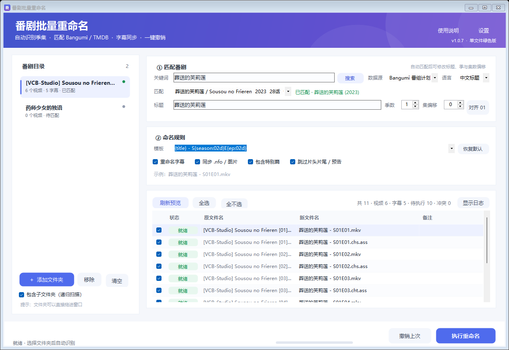

# 番剧批量重命名 · AnimeRenamer

一个面向番剧收藏的 Windows 批量重命名工具：自动识别季集、匹配 Bangumi / TMDB、同步字幕与附属文件，支持预览、冲突保护和一键撤销。




> 参考了 [Episode-ReName](https://github.com/Nriver/Episode-ReName) 的季集识别 / 命名格式思路，以及 [KimigaiiWuyi/Bangumi_Auto_Rename](https://github.com/KimigaiiWuyi/Bangumi_Auto_Rename) 的元数据匹配思路。本项目为独立实现：界面化操作，**只修改文件名，不移动目录、不做硬链接**。

---

## 下载

- 直接下载：[`dist/AnimeRenamer.exe`](dist/AnimeRenamer.exe)
- 或到 [Releases](../../releases/latest) 下载带说明的压缩包

单文件绿色版，约 186 KB，无需安装。支持 Windows 10 / 11（系统自带 .NET Framework 4.x）。

> 程序没有代码签名。首次运行如果出现 **“Windows 已保护你的电脑”**，点击 **“更多信息 → 仍要运行”** 即可。这是未签名程序的正常提示。

## 三步完成

1. **添加文件夹**：点击「添加文件夹」，或把番剧文件夹直接拖进窗口（支持一次拖入多个）。
2. **确认匹配**：程序会自动用目录名到 Bangumi 搜索并匹配；不对就改关键词重搜，或直接修改「标题」「季数」。
3. **预览并执行**：检查「原文件名 → 新文件名」，取消不想改的行，点击「执行重命名」。改完可随时「撤销上次」。

每个文件夹被视为**一部番剧**。如果一个目录下混有多部番剧，请分别添加各自的番剧文件夹。

## 功能

- **季集识别**：支持 `[01]`、`- 01`、`E01`、`EP01`、`第01话`、`S01E01`、`01v2` 等常见写法。
- **元数据匹配**：Bangumi（无需 Key）自动获取中文标题、年份、单集标题；可选 TMDB（需 API Key）。
- **命名模板**：Emby / Jellyfin / Plex / 中文话数等预设，支持单集标题、分辨率、发布组等占位符。
- **字幕同步**：字幕按集数自动配对，保留 `.chs` / `.cht` / `.jpn` 等语言后缀。
- **附属文件**：`.nfo`、缩略图等跟随视频一起改名。
- **特别篇**：`SP` / `OVA` / `OAD` 自动编号为 `S00E01`。
- **自动跳过**：`NCOP` / `NCED` / `PV` / `CM` / 预告 / 样片默认跳过。
- **安全预览**：目标已存在、新名称重复时标记为「冲突」，绝不覆盖。
- **一键撤销**：每次执行都记录历史，可完整还原。
- **批量处理**：左侧列表可同时管理多个番剧文件夹。
- **偏移对齐**：连续编号（如 25–36）可设置偏移或一键对齐到 01。
- **仅本地模式**：完全不联网，用文件夹名 + 集数直接改名。

## 命名模板

| 占位符 | 含义 | 示例 |
| --- | --- | --- |
| `{title}` | 当前标题（可手动修改） | 葬送的芙莉莲 |
| `{title_cn}` | 匹配条目的中文名 | 葬送的芙莉莲 |
| `{title_orig}` | 匹配条目的原名 | 葬送のフリーレン |
| `{season}` | 季数，`{season:02d}` 补零 | 01 |
| `{ep}` | 集数，`{ep:02d}` 补零 | 05 |
| `{ep_title}` | 单集标题 | 冒险结束 |
| `{year}` | 年份 | 2023 |
| `{resolution}` | 分辨率 | 1080p |
| `{group}` | 发布组 | VCB-Studio |

常用模板：

```text
{title} - S{season:02d}E{ep:02d}                 Emby / Jellyfin 标准
{title} - S{season:02d}E{ep:02d} - {ep_title}    附带单集标题
{title} 第{ep:02d}话                              中文话数风格
{title} - {ep:02d}                               简洁集数风格
```

## 季数、集数与偏移

- 文件名带 `SxxExx` 时，优先使用文件内的季数；否则使用界面上的「季数」。
- 输出集数 = 识别的原集数 + 「集偏移」。
- 例：文件是 `25–36`，想输出 `S02E01–E12`，把季数设为 2、偏移设为 `-24`，或直接点「对齐 01」。
- 特别篇不参与偏移，固定输出 `S00E01` 起的编号。
- 如果新名称与原名只差空格，程序会判定为「无变化」，不会重复改名。

## 数据源

| 数据源 | 是否需要 Key | 说明 |
| --- | --- | --- |
| Bangumi 番组计划 | 不需要 | 推荐，可获取中文标题、年份、话数、单集标题 |
| TMDB | 需要 API Key | 在「设置」中填写；国内网络通常需要代理 |
| 仅本地 | 不需要 | 完全不联网，用文件夹名 + 识别出的集数命名 |

TMDB Key 可在 <https://www.themoviedb.org/settings/api> 免费申请，v3 Key 或 v4 Token 均可。

## 安全与撤销

- 只修改文件名，不移动、不删除、不修改文件内容。
- 目标文件已存在或新名称重复时，该行标记为「冲突」并跳过，不会覆盖。
- 每次执行都会写入撤销历史：`%APPDATA%\AnimeRenamer\history\*.json`，点击「撤销上次」即可还原。
- 重命名采用“临时名 → 目标名”的两阶段方式，避免互相占用名称导致的失败。
- 建议先用一个小文件夹试运行，确认模板和识别结果符合预期。

## 构建

环境要求：Windows + .NET Framework 4.x（系统自带 `csc.exe`），无需 Python / Node。

```bat
build.bat
```

或：

```powershell
powershell -ExecutionPolicy Bypass -File build.ps1
```

构建产物位于 `dist\AnimeRenamer.exe`。`build.ps1 -Test` 会在编译后运行内置自测（37 项）。

GitHub Actions 会在 `windows-latest` 上自动构建并上传 EXE 产物，见 [`.github/workflows/build.yml`](.github/workflows/build.yml)。

## 目录结构

```text
src/
  Program.cs       入口、命令行参数
  MainForm.cs      主界面
  Theme.cs         主题、卡片与自绘按钮
  NameParser.cs    季集识别、标题清洗、模板
  Metadata.cs      Bangumi / TMDB 客户端
  Planner.cs       文件配对、冲突检测、命名计划
  Renamer.cs       两阶段改名、历史与撤销
  Config.cs        配置
  SettingsForm.cs  设置窗口
  HelpForm.cs      使用说明
  SelfTest.cs      内置测试
docs/              截图
dist/              编译好的 EXE 与使用说明
build.ps1          csc 编译脚本
build.bat          Windows 双击构建入口
```

## 已知限制

- 一个文件夹按一部番剧处理，不支持在一个根目录里自动拆分多部番剧。
- 无法识别集数的文件（如电影、无编号特别篇）会标记为「未识别」，不会改名。
- 不修改 `.nfo` 内部引用，也不重写字幕内容；Emby / Jellyfin 会自动重新刮削。
- 字幕只改名，不移动目录；如果字幕在 `Subs` 子目录中，部分媒体库可能仍需要手动放到视频同目录。
- Bangumi / TMDB 的可用性取决于网络；匹配结果仍需人工确认。
- 程序未签名，部分杀毒软件可能误报；如介意可自行用 csc 从源码构建。

## 许可证

[MIT](LICENSE) © 2026 AnimeRenamer contributors

本项目仅供个人学习与整理本地收藏使用，请遵守相关 API 的使用条款。
